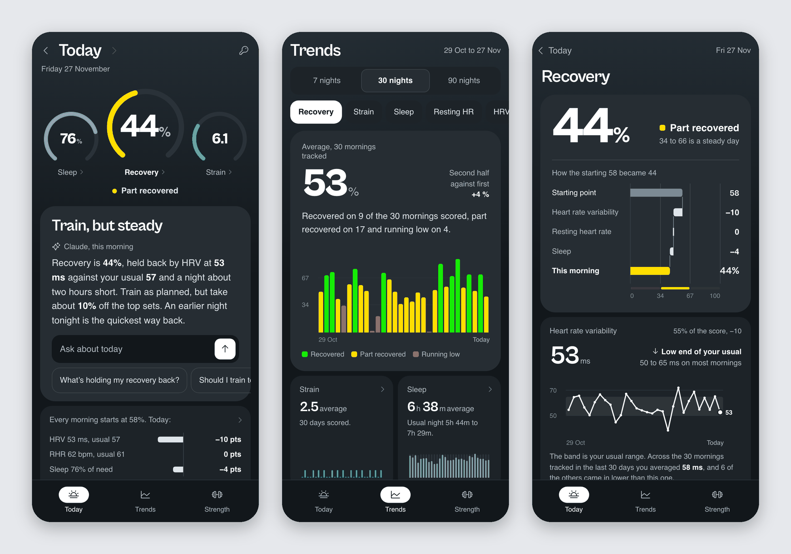

# Wahey: a personal recovery app

[](https://github.com/SammyJ3000/wahey/actions/workflows/ci.yml)



*Screenshots use fictional demo data.*

## What it is

I built my own Whoop style recovery app. It gives me a recovery score each morning, plus strain, sleep and trends, from a cheap watch, a smart scale and my gym app. Claude reads the numbers and gives me a short call for the day. I also made a YouTube video about it: https://youtu.be/YKrMGia0X2Y

It is one person's app, not a product. There is no subscription and no build step.

The person in this repo is fictional. The coach prompts describe "Alex", 34, an office worker who trains three times a week. The demo data is generated by a script and is made up. No real health data is in this repo.

This is a personal project. It is not medical advice and the scores are not medical measures.

## How it works

```
Watch -> Zepp -> Apple Health -> iPhone Shortcut (when the alarm stops)
                                        |
                                        v
                               POST /api/health ---> Vercel Blob store
                                        ^                    |
intervals.icu (HRV, sleep) -------------+                    v
Gym app backup (read only) --> /api/gym --------------> index.html (scores worked out here)
                                                             |
                                                             v
                                         /api/coach, /api/chat, /api/journal (Claude)
                                                             |
                                                             v
                                              morning call, chat answers, habits
```

1. An iPhone Shortcut runs when the alarm is stopped. It reads the last two days from Apple Health and posts them to `api/health.js`. The steps are in `docs/iphone-shortcut.md`.
2. `lib/summarise.js` turns the raw samples into one summary per day: HRV, resting heart rate, sleep and its stages, minutes in each heart rate band, steps, weight and so on. A night's sleep belongs to the morning it ends.
3. Each time the app opens, `lib/intervals.js` fills gaps with HRV and sleep from intervals.icu, because my watch app never writes those to Apple Health.
4. `api/gym.js` reads my gym app's backup, read only, and passes on sessions, sets, top sets and estimated one rep maxes.
5. The app (`index.html`) works out recovery, strain, sleep need and the bedtime from the stored days. The maths is in `lib/score.js`, which the page loads as a plain script, so tuning it never needs an API change and the same code runs in the tests.
6. Claude does three jobs:
   - `api/coach.js` writes the morning call from today's numbers and the last week. The prompt is in `prompts/coach.md`. One call a day is cached, and it is asked again only when the score changes.
   - `api/chat.js` is "Ask the coach", a conversation about the day's numbers with a short list of facts about the user. The prompt is in `prompts/chat.md`.
   - `api/journal.js` turns a line from the journal ("two pints, phone in bed till 1") into habits, so the app can set them against the next morning's recovery. The prompt is in `prompts/journal.md`.

## Design decisions

**Memory in chat is approved by the user.** Claude never saves anything by itself. If the user says something lasting, such as an injury or a schedule, Claude may end its reply with one line in the form `REMEMBER: the fact`. The server strips that line from the answer and stores it on the message as a suggestion. It only goes into memory when the user taps it. The user can edit or delete any line. The parser only accepts the last line in capitals, so a sentence that starts "Remember:" stays in the answer. A fact that is already known is not suggested again.

**Habit extraction returns JSON, and the code does not trust it.** The journal prompt asks for one JSON object and nothing else. `extractHabits` in `api/journal.js` still copes with code fences, a sentence around the JSON, a bare array and trailing commas. Slugs are steered to a fixed list (`alcohol`, `late_meal`, `screen_in_bed` and so on), with aliases, so the same habit lands on the same name every day. If Claude cannot be reached, the note is still saved. The prompt also says the note is only data, so instructions inside it are ignored.

**Everything is compared with your own normal.** Recovery is not measured against population averages. HRV and resting heart rate are held against the user's own last 30 days. A normal morning scores 58, and HRV above or below your usual moves it most. HRV counts as a ratio to your usual and is capped both ways, so one odd night cannot swing the score to an extreme. There is no score until there are 5 earlier nights, and the screens say "still learning your normal" until there are 30. The research behind the shape is in `docs/scoring-research.md`. These are my own approximations, not a copy of any commercial formula.

**Honest about gaps.** No number is ever invented. If there is no HRV, there is no recovery score, and the app says what is missing. The coach prompts tell Claude the same: never invent a number, a session or a trend.

**Prompts and the model live outside the code.** Prompts are Markdown files in `prompts/`. The model name is in `config.json`. A morning call that hits the token limit is never shown or cached.

## What broke and how I fixed it

The full list of changes is in `CHANGELOG.md`.

- **The morning call stopped mid sentence.** The model thinks before it writes, and thinking counts against `max_tokens`. The limit was too low. I raised it, and a reply cut short is now never shown or saved.
- **Afternoon heart rate landed in the morning.** The iPhone was on the 12 hour clock and the date parser ignored "pm". A gym session's heart rate window came up empty. I fixed the parser in `lib/summarise.js` to honour am and pm.
- **No HRV or sleep from the phone.** Zepp writes neither to Apple Health, and an empty Health query stops the whole Shortcut. I took HRV and sleep from intervals.icu instead and fill gaps on every load.
- **HRV still went missing some mornings.** intervals.icu only pulls from Zepp when its website is opened, and Zepp's feed runs about a day behind. I added a way to type the figure in from the Zepp app. The real figure replaces it when it arrives.
- **Sleep was short and steps were doubled.** Apple Health's sleep stages added up to less than Zepp's total, and Health counted phone and watch steps together. Zepp's totals now win, and the stages are stretched to match.
- **The score jumped around in the first weeks.** The first version scored HRV against the spread of recent nights. With only a few similar nights the spread was tiny, so small changes looked huge. I added a minimum spread at first, then changed the scoring to compare HRV with your usual as a capped ratio, which does not depend on the spread at all.
- **A gym session was filed under the wrong day.** The gym app kept the day an unused session was opened. `config.json` has a `gym_corrections` block for one off fixes like this. It is never written back to the gym app.

## Setup and run

You need Node 22 or later.

### Run it locally with demo data

```
node executions/make_sample_data.js     # or: npm run sample-data
node executions/dev-server.js           # or: npm start
```

Open http://localhost:4321. With no `.env`, the dev server uses a local passphrase and hands it to the page, so it opens straight away. Data is read from and written to `tmp/store/`. The sample data is 60 fictional days for Alex.

Without `ANTHROPIC_API_KEY` the scores and screens still work. The Claude parts do not: the morning call does not come through, the chat says the key is not set, and journal notes are saved without habits pulled out of them.

To try the Claude parts, copy `.env.example` to `.env` and fill in `ANTHROPIC_API_KEY`. If you also set `APP_KEY`, the page asks for it. Run `node executions/dev-server.js --dev-key` to keep your API keys but use the local passphrase.

### Tests and lint

```
npm test
```

This runs the tests in `tests/` with Node's built in test runner. `tests/test-score.js` checks the scoring maths in `lib/score.js`: the recovery parts, the caps, the strain scale, the strain target and the bedtime. `tests/test-api-chat.js` checks the chat API offline: the `REMEMBER:` parsing, the memory rules and the handler. `fetch` is stubbed, so the tests need no network, no key and no `npm install`.

```
npm install
npm run lint
```

`npm run lint` checks `api/`, `lib/`, `executions/` and `tests/` with ESLint. `index.html` is not linted, because its React code is compiled in the browser. `.github/workflows/ci.yml` runs the lint and the tests on every push and pull request.

### Deploy to Vercel

1. `npm install` (the only runtime dependency is `@vercel/blob`; ESLint is a dev dependency).
2. Create a Vercel project from this folder and connect a private Blob store. Vercel adds `BLOB_READ_WRITE_TOKEN` itself.
3. Add `APP_KEY` and `ANTHROPIC_API_KEY`. The optional ones are `GYM_API_URL` and `GYM_BACKUP_KEY` for a gym app backup, and `INTERVALS_ATHLETE_ID` and `INTERVALS_API_KEY` for intervals.icu. `executions/push_env.sh` copies the filled in keys from `.env` to Vercel without printing them.
4. Deploy, then build the iPhone Shortcut from `docs/iphone-shortcut.md`.

Other scripts:

- `executions/import_health_export.js` backfills from Apple Health's "Export All Health Data" zip, into the local store or a live deploy.
- `api/gym.js` expects a backup in my gym app's format. Without `GYM_API_URL` the app runs without gym data.

## Stack

- React 18 and Babel standalone from a CDN, in one `index.html`, with the scoring maths beside it in `lib/score.js`. No build step. The front end is one page on purpose: it deploys as static files with nothing to compile, and the interface reads top to bottom in one place.
- Vercel serverless functions in Node (`api/`), shared logic in `lib/`.
- Vercel Blob for storage. Plain files in `tmp/store/` when run locally.
- The Claude API, called with plain `fetch`. No SDK.
- Apple Health through an iPhone Shortcut, intervals.icu, and a gym app's backup.
- Phosphor icons. Cabinet Grotesk and General Sans fonts.

## About me

I'm Sam Jordan. I design and build apps and AI tools with Claude Code. More of my work: https://sam-jordan-cv.vercel.app
